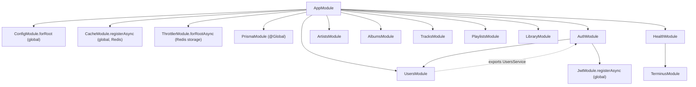

# Architecture & Tech Stack

## Tech stack

| Concern | Choice | Why |
| --- | --- | --- |
| Runtime | Node.js 24, TypeScript 5.9 | LTS |
| Framework | **NestJS 11** (CommonJS) | Course track. v11 instead of v12 because v12 is ESM-only and doesn't fit Jest well. |
| Database | PostgreSQL 17 | Relational data, FKs, transactions |
| ORM | **Prisma 7** (`prisma-client` generator, `@prisma/adapter-pg`) | Type-safe queries, migrations |
| Cache | Redis 8 via `@nestjs/cache-manager` + Keyv (`@keyv/redis`) | Shared cache with TTL |
| Rate limiting | `@nestjs/throttler` + `@nest-lab/throttler-storage-redis` | Limits are shared across instances |
| Auth | `@nestjs/jwt` (access token), opaque rotating refresh token, argon2id | No Passport, so the Guard logic is plain to see |
| Validation | `class-validator` + `class-transformer` via global `ValidationPipe` | |
| Config | `@nestjs/config` with a validated schema (`env.validation.ts`) | Fails fast on bad env |
| Logging | Nest `ConsoleLogger` (JSON in production) + request-id middleware | Built-in, structured |
| API docs | `@nestjs/swagger` + CLI plugin (DTO comments → schema) | `/docs`, `/docs-json` |
| Health | `@nestjs/terminus` | `/api/health` checks DB + Redis |
| Security | `helmet`, CORS allow-list, argon2, parameterised SQL (Prisma) | OWASP basics |
| Tests | Jest 30, `@nestjs/testing`, supertest | unit / e2e / system |
| Packaging | pnpm 10, Docker (multi-stage, non-root), docker compose | One-command run |
| CI/CD | GitHub Actions → GHCR image | |

## Repository layout

```text
.
├── docker-compose.yml          # postgres + redis + app (one command)
├── .github/workflows/ci-cd.yml
├── docs/
└── app/                        # the NestJS project
    ├── Dockerfile
    ├── prisma/                 # schema, migrations, seed.ts
    ├── src/
    │   ├── main.ts / app.setup.ts / app.module.ts
    │   ├── config/             # env validation
    │   ├── prisma/             # PrismaModule (@Global) + PrismaService
    │   ├── common/             # cross-cutting: filter, interceptor, middleware, throttler guard, pagination
    │   ├── auth/               # AuthModule, JwtAuthGuard, RolesGuard, decorators
    │   ├── users/  artists/  albums/  tracks/  playlists/  library/  health/
    │   └── generated/prisma/   # generated client (git-ignored)
    └── test/                   # e2e (+ setup) and system/
```

## Module graph



- **Dynamic modules**: `ConfigModule.forRoot`, `CacheModule.registerAsync`, `ThrottlerModule.forRootAsync` and `JwtModule.registerAsync` are all configured by factories that inject `ConfigService`.
- **Import/export**: `UsersModule` exports `UsersService`, and `AuthModule` imports it. `PrismaModule` is `@Global()`, so feature modules can inject `PrismaService` without importing the module.
- **App-wide providers** are registered in `AppModule` with the `APP_GUARD`, `APP_PIPE` and `APP_FILTER` tokens. They are created through DI, so they can inject other providers. `app.useGlobalGuards(new X())` could not do that.

## Request lifecycle

Order for every request: **Middleware → Guards → Interceptors (before) → Pipes → Handler → Interceptors (after) → Exception filters**.

Example: `POST /api/playlists/:id/tracks` (add a track to a playlist).

```mermaid
sequenceDiagram
    autonumber
    participant C as Client
    participant MW as RequestLoggerMiddleware
    participant G1 as JwtAuthGuard (global)
    participant G2 as UserThrottlerGuard (global)
    participant G3 as RolesGuard (global)
    participant G4 as PlaylistOwnerGuard (route)
    participant P as ValidationPipe
    participant H as PlaylistsController.addTrack
    participant S as PlaylistsService
    participant DB as PostgreSQL
    participant F as PrismaExceptionFilter

    C->>MW: POST /api/playlists/:id/tracks {trackId}
    MW->>MW: set X-Request-Id, start timer
    MW->>G1: next()
    G1->>G1: verify Bearer JWT → req.user (401 if missing/invalid)
    G1->>G2: 
    G2->>G2: Redis counter keyed by user id (429 if over limit)
    G2->>G3: 
    G3->>G3: no @Roles on route → pass (403 on role mismatch elsewhere)
    G3->>G4: 
    G4->>DB: SELECT ownerId FROM Playlist WHERE id = :id
    G4->>G4: 404 if missing, 403 if not owner/admin
    G4->>P: 
    P->>P: AddTrackDto: trackId must be UUID, no extra fields (400)
    P->>H: dto
    H->>S: addTrack(id, trackId)
    S->>DB: BEGIN; SELECT max(position); INSERT PlaylistTrack; COMMIT
    alt duplicate / unknown track
        DB-->>S: P2002 / P2003
        S-->>F: PrismaClientKnownRequestError
        F-->>C: 409 Conflict
    else ok
        S-->>H: row
        H-->>C: 201 Created
    end
    MW->>MW: on finish: log {requestId, method, url, status, ms, userId}
```

### Why the pieces sit where they do

| Piece | Mechanism | Reason |
| --- | --- | --- |
| Request id + access log | **Middleware** | Runs before guards, so 401/403/429 responses are logged too. `res.on('finish')` sees the final status code. |
| Authentication | **Global guard** + `@Public()` | Routes are protected unless marked public, so a new endpoint can't be left open by accident. |
| Rate limit | **Global guard** (after auth) | Keyed by user id when authenticated (running after auth makes `req.user` available), otherwise by IP. |
| Role check | **Global guard** + `@Roles([...])` | Declarative. No `if (user.role …)` inside handlers. |
| Ownership check | **Route guard** `PlaylistOwnerGuard` | Needs DI (`PrismaService`) and route params. Applied only where needed. |
| Input validation | **Global `ValidationPipe`** (`whitelist`, `forbidNonWhitelisted`, `transform`) + `ParseUUIDPipe` | Bad input is rejected before it reaches business logic. |
| Response caching | **Interceptor** `HttpCacheInterceptor` | Needs to wrap the handler: skip it on a cache hit, store its result on a miss. |
| DB error → HTTP | **Exception filter** `PrismaExceptionFilter` | One mapping for the whole app. Services let the DB enforce constraints. |
| Current user | **Custom param decorator** `@CurrentUser('id')` | Handlers don't touch `req`. |

## Dependency injection & lifecycle

- Every provider uses the default **singleton scope**: one instance per app, created at bootstrap. This includes `PrismaService`, which holds one connection pool. Request scope is not used: per-request data lives on `req.user`, so no provider needs to be rebuilt per request, and request scope would cascade to every provider that depends on it.
- `PrismaService extends PrismaClient`. Its constructor injects `ConfigService` for `DATABASE_URL`, and it implements `OnModuleDestroy` to disconnect. `enableShutdownHooks()` in `app.setup.ts` makes SIGTERM (e.g. `docker stop`) run that hook.
- Tests replace providers through DI. For example, `auth.service.spec.ts` builds a `TestingModule` with fake `UsersService` and `PrismaService` and a real `JwtService`.

## Caching (Redis)

- Only **user-agnostic** endpoints are cached: the catalog controllers (`artists`, `albums`, `tracks`). The key is `http:<originalUrl>` (path + query), and entries expire after `CACHE_TTL_MS` (30 s).
- Every response carries an `X-Cache: HIT|MISS` header, so you can see the cache working from Swagger or curl.
- **Invalidation**: a successful admin write (POST/PATCH/DELETE) on a catalog controller runs `cache.clear()`. That clears only the `cache` Keyv namespace, not the throttler keys. This is coarse on purpose (writes are rare). Tagged or versioned keys would be the upgrade.
- Play counts and likes are not in cached routes, so they don't invalidate anything. `/tracks/top` is allowed to be up to 30 s stale.

## Rate limiting (Redis)

| Scope | Limit | Where |
| --- | --- | --- |
| Default | 100 req / 60 s per user (or IP) | `THROTTLE_*` env, `ThrottlerModule.forRootAsync` |
| Auth endpoints | 10 / 60 s per IP | `@Throttle` on `AuthController` (brute-force protection) |
| Record a play | 30 / 60 s per user | `@Throttle` on `POST /tracks/:id/play` (anti play-count inflation) |
| Health | skipped | `@SkipThrottle()` |

Responses include `X-RateLimit-Limit/Remaining/Reset`; over the limit returns **429**.

## Auth design

- **Access token**: JWT (HS256), 15 min, payload `{ sub, email, role }`. It's verified by `JwtAuthGuard` with no DB hit. Trade-off: a role change takes effect when the token expires.
- **Refresh token**: opaque `<uuid>.<random 32 bytes>`. Only `sha256(secret)` is stored (fast lookup by id, nothing useful if the DB leaks). It is **rotated** on every refresh, in a transaction. If a revoked token is presented again, that counts as **reuse** (likely theft), and **all** of the user's sessions are revoked.
- Passwords use **argon2id**. Login returns the same error for an unknown email and a wrong password.

## Configuration

`ConfigModule.forRoot({ validate })` turns `process.env` into an `EnvironmentVariables` instance (with type coercion) and **refuses to boot** if something is missing or invalid, e.g. a JWT secret shorter than 32 characters. `.env` (git-ignored) is used for dev, `.env.test` for tests, and real environment variables in Docker/CI. See `app/.env.example`.

## Logging

Nest's built-in `ConsoleLogger` prints pretty output in dev and **JSON** when `NODE_ENV=production` (the Docker image), e.g.

```json
{"level":"log","context":"HTTP","message":{"requestId":"f0cf…","method":"GET","url":"/api/health","status":200,"ms":2}}
```

Clients can send their own `X-Request-Id`, which is echoed back so one request can be traced across logs.

## Security checklist (OWASP awareness)

- Passwords: argon2id. Refresh tokens: hashed. Secrets only in env (nothing committed except dev defaults in `.env.example`/`.env.test`).
- Injection: Prisma uses parameterised queries. The only raw SQL is a constant `SELECT 1`.
- Input: whitelist validation rejects unknown fields (no mass assignment of `role`), UUID pipes, bounded `limit`.
- Access control: auth by default, RBAC, ownership guard, private playlists return 404 (existence isn't leaked).
- Headers: `helmet` (CSP, nosniff, frame-ancestors…). CORS allow-list from `CORS_ORIGINS`.
- Abuse: rate limits on auth and plays.
- Container: runs as the non-root `node` user, prod dependencies only.

## Testing strategy

| Level | Tool | Runs against | Command |
| --- | --- | --- | --- |
| Unit | Jest + `@nestjs/testing` | Mocks (no I/O) | `pnpm test` / `pnpm test:cov` |
| E2E | Jest + supertest | Whole Nest app in-process + real Postgres/Redis (test DB, re-seeded each run) | `pnpm test:e2e` |
| System | Jest + `fetch` | The deployed container (`docker compose up`), black-box | `pnpm test:system` |

The e2e global setup refuses to wipe a database whose name doesn't end in `_test`.

## CI/CD

`.github/workflows/ci-cd.yml`:

1. **test**: install → lint → build → unit tests with coverage → e2e, with Postgres/Redis service containers.
2. **system**: `docker compose up --build --wait` → system tests (prints container logs on failure).
3. **publish** (push to `main` only, after both pass): build and push `ghcr.io/<owner>/<repo>:latest` and `:sha-…`.
