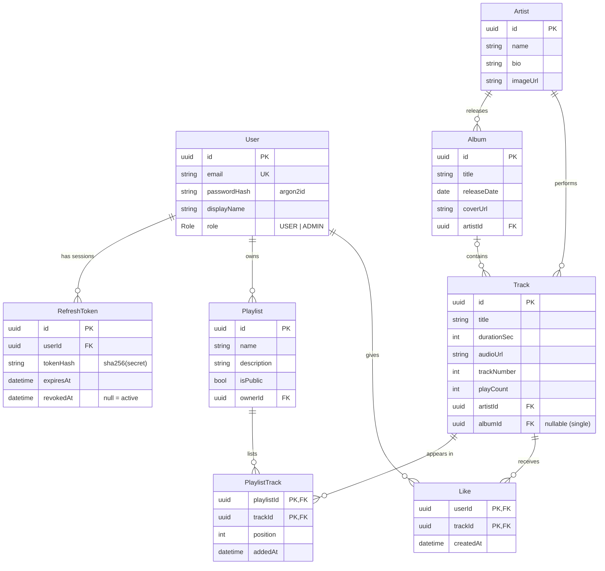

# Relational Data Model

PostgreSQL 17, managed by Prisma 7. Source of truth: [`app/prisma/schema.prisma`](../app/prisma/schema.prisma); migrations in `app/prisma/migrations/`.

## ERD

All tables also have `createdAt`; mutable ones have `updatedAt`.

## Tables

| Table | Key | Notes |
| --- | --- | --- |
| `User` | `id` (uuid) | `email` unique (normalised to lowercase by the DTO). Password hashed with argon2id; hash is never returned by the API (`publicUserSelect`). |
| `RefreshToken` | `id` (uuid) | Client holds `<id>.<secret>`; DB stores only `sha256(secret)`. Revoked on rotation/logout; kept for reuse detection. |
| `Artist` | `id` | |
| `Album` | `id` | Belongs to one artist. |
| `Track` | `id` | Belongs to one artist, optionally one album (singles). `playCount` incremented atomically in SQL. |
| `Playlist` | `id` | `isPublic = false` → only owner/admin can read it. |
| `PlaylistTrack` | (`playlistId`, `trackId`) | Join table with explicit `position` (0..n-1, kept contiguous by transactions). Composite PK = a track appears once per playlist. |
| `Like` | (`userId`, `trackId`) | Composite PK = one like per user per track (makes "like" idempotent). |

## Integrity rules (enforced by the database)

| Rule | Mechanism | API result |
| --- | --- | --- |
| Unique email | `@unique` | `P2002` → **409** |
| No duplicate track in a playlist / like | composite PK | `P2002` → **409** (like uses upsert → no error) |
| Referenced artist/album/track must exist | FK | `P2003` → **409** |
| Update/delete of a missing row | — | `P2025` → **404** |
| Delete artist → its albums & tracks go | `onDelete: Cascade` | |
| Delete album → tracks become singles | `onDelete: SetNull` | |
| Delete user/playlist/track → join rows go | `onDelete: Cascade` | |

The mapping from Prisma error codes to HTTP lives in one place: `PrismaExceptionFilter`. Services don't pre-check (which would race); they let the DB decide.

## Indexes

| Index | Serves |
| --- | --- |
| `Track(playCount DESC)` | `GET /tracks/top` |
| `Track(artistId)`, `Track(albumId)`, `Album(artistId)` | filters + FK joins |
| `Artist(name)`, `Album(title)`, `Track(title)` | ordering / prefix lookups (the `?q=` contains-search is `ILIKE '%q%'` and is not index-backed; fine at demo size) |
| `PlaylistTrack(playlistId, position)` | ordered playlist reads |
| `Like(trackId)`, `RefreshToken(userId)`, `Playlist(ownerId)` | reverse lookups, "revoke all sessions" |

## Transactions

| Operation | Why a transaction |
| --- | --- |
| Refresh-token rotation | Revoke old + create new must be atomic; the conditional `updateMany … where revokedAt IS NULL` makes concurrent refreshes race-safe (only one wins). |
| Add track to playlist | Read `max(position)` + insert as one unit. |
| Remove track | Delete + shift following positions down. |
| Reorder | All positions rewritten or none; validated to be exactly the current set. |
| Paginated lists | `findMany` + `count` in one batch transaction → consistent `meta.total`. |
